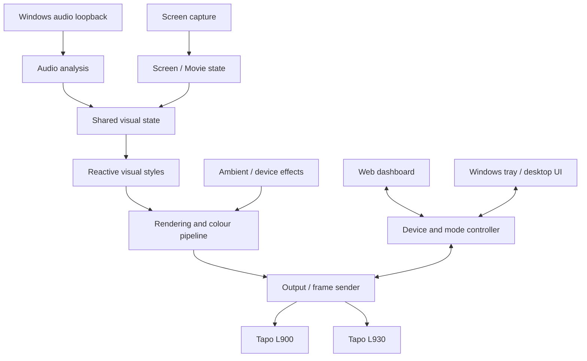

<div align="center">


<br>

[](https://www.python.org/)
[](#compatibility)
[](LICENSE)

# Summer, Please Turn Off the Lights

### Local-first lighting for music, movies, and whatever mood this is.

**Rick has delegated lighting duty to Summer.** He calls it an internship. Morty has questions. The LEDs, fortunately, don't ask for hazard pay.

A Windows desktop app and web dashboard for controlling TP-Link Tapo light strips, with music-reactive visuals, screen-aware ambience, and a library of ambient and animated effects.

[Features](#-what-it-does) · [Quick start](#-quick-start) · [Preview gallery](#-preview-gallery) · [Configuration](#-configuration) · [Troubleshooting](#-troubleshooting) · [Development](#-development)

<br>


<sub>Pulse mode · A simulated 50-zone preview, not a recording from physical hardware.</sub>

</div>

---

## ✨ What it does

- **Music-reactive lighting** — visual styles driven by desktop audio capture, including Pulse, Spectrum, and Flow.
- **Screen-aware ambience** — Movie mode samples on-screen colours and luminance to create room lighting that complements what's playing.
- **Ambient and animated effects** — slow gradients, breathing light, ocean-inspired motion, embers, comets, rain, and other effects, with availability depending on the selected device and firmware.
- **Two ways to control it** — a browser dashboard on your local network, plus a Windows desktop/tray experience.
- **Local-first device control** — runtime commands are sent over your LAN after the device session is established. Initial Tapo setup and authentication may still require the Tapo account ecosystem.
- **Configurable per-device output** — define device addresses, names, models, and available calibration settings in YAML.

The goal is simple: responsive lighting without turning every frame into a trip through a remote service.

## 🧩 Compatibility

| Area | Support |
| --- | --- |
| Operating system | Windows 10 / 11 |
| Python | 3.13 |
| Light devices | Tapo L900 and L930 configurations |
| Audio | Windows desktop audio loopback |
| Screen capture | Windows desktop capture APIs |
| Network | PC and lights reachable on the same local network |
| License | MIT |

> [!IMPORTANT]
> The L930 is a 50-zone addressable strip, so its effects and transition behaviour differ from the single-zone L900. The L930 effects engine and music-reactive output are still being refined against real devices. GIFs and automated tests help with development, but they do **not** prove that every effect looks perfect on every strip or firmware version.

---

## ⚡ Quick start

### 1. Install prerequisites

Install **Git** and **Python 3.13** on Windows. Make sure your light strip is set up in the Tapo app and is reachable from the same network as your PC.

### 2. Clone this repository

Run these commands in PowerShell:

```powershell
git clone https://github.com/iamp1000/summer-turn-the-light-off-.git
cd summer-turn-the-light-off-
```

### 3. Create a virtual environment

```powershell
py -3.13 -m venv .venv
.\.venv\Scripts\Activate.ps1
python -m pip install --upgrade pip
pip install -r requirements.txt
```

If PowerShell blocks virtual-environment activation, you can run the environment's Python directly as `.venv\Scripts\python.exe`, or use Command Prompt and `.venv\Scripts\activate.bat`.

### 4. Add your Tapo credentials

Copy the example file:

```powershell
Copy-Item .env.example .env
```

Open `.env` and enter the credentials used for your Tapo account:

```dotenv
TAPO_EMAIL=your_tapo_email@example.com
TAPO_PASSWORD=replace_with_your_password

# Optional dashboard access token
TAPO_WEB_TOKEN=
```

Keep `.env` private. Never paste your password or token into an issue, screenshot, commit, or chat.

### 5. Configure your light strip

Copy the sample configuration:

```powershell
Copy-Item config.example.yaml config.yaml
```

Edit `config.yaml` and replace the sample IP addresses with the actual local IP addresses of your devices. For example:

```yaml
tapo:
  devices:
    strip1:
      ip: "192.168.1.145"
      name: "Desk"
      model: "L900"

    strip2:
      ip: "192.168.1.146"
      name: "Backboard"
      model: "L930"
```

Use the device models and configuration options supported by your setup. Reserving each strip's IP address in your router can prevent the address from changing unexpectedly.

### 6. Launch

```powershell
py -3.13 -m src.main
```

You can also launch the app with `run_lights.bat`. Once it starts, open the dashboard on the PC:

**http://localhost:8765**

To use it from a phone or another device on your Wi-Fi, open `http://<your-pc-lan-ip>:8765`. The exact address is printed by the app at startup.

---

## 🎞️ Preview gallery

These animations are renderer previews, useful for showing the intended visual direction. They are **simulated output**, not measured footage from a physical Tapo strip.

| Style | Preview | Intent |
| --- | --- | --- |
| **Pulse** |  | Beat-aware swells and rhythmic movement |
| **Spectrum** |  | Frequency-shaped colour and energy |
| **Flow** |  | Organic colour movement |
| **Movie** |  | Screen-informed ambient lighting |

<details>
<summary><strong>Dashboard screenshots</strong></summary>

<br>

| Pulse | Spectrum |
| --- | --- |
|  |  |

| Flow | Movie |
| --- | --- |
|  |  |

</details>

---

## 🎨 Effects and visual styles

The project has two related layers:

- **Reactive visual styles** respond to audio or screen state. The main styles include Pulse, Spectrum, Flow, and Movie.
- **Device effects** create standalone ambient or animated scenes. Examples include Tide, Drift, Breathe, Starfield, Embers, Lava Lamp, Golden Hour, Comet, Aurora, Deep Ocean, Rain, and Rainbow-style effects.

The available effect set depends on the device and the current implementation. Some L930 effects run on the strip's firmware; others are rendered by the app and sent as zone updates. That difference affects how they behave, how often the PC needs to send updates, and how transitions look.

The priority is **reliable effect switching, smooth transitions, and meaningful music response** before adding an endless list of near-duplicate effects. A longer menu isn't better if half of it looks like the lights are receiving a distress signal.

---

## 🏗️ How it fits together



The code is organised around a few main areas:

| Area | Responsibility |
| --- | --- |
| `src/main.py` | App startup, configuration, and component wiring |
| `src/audio_dsp.py` | Audio analysis and shared music state |
| `src/visual_styles.py` | Reactive visual styles |
| `src/effects.py` | L900 effect logic |
| `src/effects_l930.py` | L930 effect catalogue and rendering/control logic |
| `src/webapp.py` | Web dashboard and API |
| `src/pipeline.py` | Colour conversion and rendering helpers |

---

## 🔐 Privacy and network safety

- **Local control is not the same as zero cloud involvement.** Initial account setup and authentication can depend on the Tapo ecosystem; runtime device commands are intended to run over your local network.
- **The dashboard may be reachable from your LAN.** Check the `web.host`, `web.port`, and authentication settings in `config.yaml`. The sample host is `0.0.0.0`, which listens on network interfaces, not just the local PC.
- **Use a dashboard token on shared networks.** Configure `TAPO_WEB_TOKEN` and the relevant app settings when you do not want other devices on the LAN to have open access.
- **Do not expose the dashboard directly to the public internet.** Use a properly secured remote-access setup instead.
- **Keep secrets out of Git.** Do not commit `.env`, real device configuration, account credentials, or logs containing sensitive details.

---

## 🛠️ Troubleshooting

<details>
<summary><strong>The app cannot connect to a strip</strong></summary>

- Check that the PC and strip are on the same reachable LAN/subnet.
- Confirm the configured IP address matches the strip's current address.
- Check router settings for client/AP isolation.
- Verify the Tapo credentials in `.env` and confirm that the device is available in the Tapo app.

</details>

<details>
<summary><strong>The dashboard does not open</strong></summary>

- Check the terminal for startup or configuration errors.
- Try [http://localhost:8765](http://localhost:8765) on the PC running the app.
- Confirm that port `8765` is not already in use; change `web.port` in `config.yaml` if needed.
- For access from another device, check the PC's LAN IP and Windows Firewall rules.

</details>

<details>
<summary><strong>Music reactivity appears inactive or inaccurate</strong></summary>

- Play audio through the Windows output device you want to capture.
- Check the selected audio input source in the dashboard.
- Check Windows sound settings and the app's sensitivity settings.
- Remember that device transport and audio analysis are separate parts of the pipeline; working audio input does not by itself confirm that a physical strip is receiving frames correctly.

</details>

<details>
<summary><strong>Can I run it on Linux or macOS?</strong></summary>

The current app is **Windows-first** and relies on Windows-specific audio, screen-capture, and desktop APIs. Linux and macOS are not currently documented as supported platforms.

</details>

---

## 🧪 Development

Create and activate the virtual environment as described above, then install the runtime dependencies:

```powershell
pip install -r requirements.txt
```

Run the automated test suite:

```powershell
python -m pytest tests/ -v
```

If pytest is not installed in your environment, add it with `python -m pip install pytest`.

You can also run a basic syntax compilation check:

```powershell
python -m compileall -q src tests
```

### Working on the project

- **L930 effects:** start in `src/effects_l930.py` and the effect registry.
- **L900 effects:** start in `src/effects.py`.
- **Music-reactive styles:** start in `src/visual_styles.py` and the audio state in `src/audio_dsp.py`.
- **Previews:** inspect the existing rendering utilities and assets before introducing new ones.

For effect work, test the simulated output first and then validate the result on physical hardware. In particular, look for abrupt colour jumps, stale frames after switching modes, flicker, effects that appear identical, and controls that do not visibly change the result.

### Contribution guidelines

1. Keep changes focused and explain the user-visible behaviour they change.
2. Add or update tests for logic that can be verified without hardware.
3. State clearly when hardware testing was or was not performed.
4. Never include credentials, private IP details that should not be public, or other secrets in commits.

---

## 🙌 Credits and disclaimer

- **Lighting inspiration:** [WLED](https://github.com/Aircoookie/WLED) and [FastLED](https://github.com/FastLED/FastLED).
- **Colour science:** [OKLab](https://bottosson.github.io/posts/oklab/) by Björn Ottosson.
- **Fan reference:** Summer Smith, Rick, and Morty belong to their respective creators and rights holders. This project is an independent fan-flavoured software project, not affiliated with or endorsed by *Rick and Morty*.
- **Device disclaimer:** This is an independent project, not affiliated with, endorsed by, or supported by TP-Link or Tapo. Their names and marks belong to their respective owners.
- **License:** [MIT](LICENSE).

---

<div align="center">

**Summer handles the lights. Rick takes the credit. Morty presses the wrong button.**

<sub>May your colours be smooth and your transitions less dramatic than a Smith family outing.</sub>

</div>
