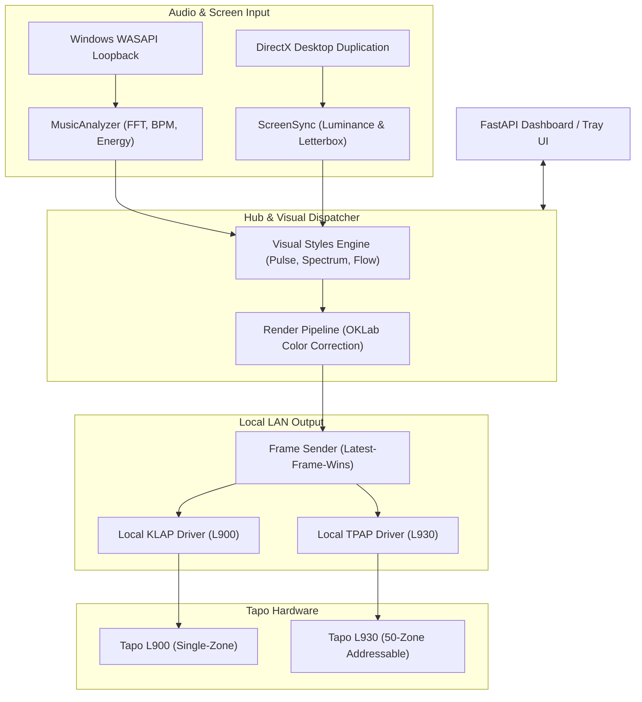

<div align="center">


<br/>

[](https://python.org)
[](#-compatibility)
[](LICENSE)

# 💡 Summer, Please Turn Off The Lights

### *Make your lights move with your music. Keep control local.*

A Windows desktop app and audio-reactive lighting engine for TP-Link Tapo smart light strips. Sync your lighting to music, movies, and ambient effects over your local network.

Summer has been assigned lighting duty. Rick built the lab, Morty is not allowed near the power strip, and this project is the attempt to make the chaos reproducible.

[Features](#-feature-highlights) • [Compatibility](#-compatibility) • [Quick Start](#-quick-start) • [Showcase](#-modes-showcase) • [Troubleshooting](#-troubleshooting) • [Architecture](#-architecture--performance) • [Effects Catalog](#-complete-effects-catalog) • [Contributing](#-contributing--development)

<br/>


<p align="center"><em>Pulse mode — simulated output for the 50-zone Tapo L930 addressable light strip.</em></p>

</div>

---

## ✨ Feature Highlights

* 🎵 **Music-Reactive Lighting:** Real-time desktop audio loopback capture with sub-5ms FFT analysis, transient kick detection, and tempo tracking. Colors dynamically shift across perceptual OKLab gradients with no muddy brown or grey midtones.
* 🎬 **Cinematic Movie Ambilight:** Screen-reactive lighting that complements what is playing on your display, featuring automated GPU black-bar detection (letterbox/pillarbox) and low-frequency impact flares.
* 🌈 **Ambient & Firmware Effects:** Viscous molten metaballs (*Lava Lamp*), ember crawls (*Hearth*), and circadian twilight glides (*Dusk*), plus 60+ FPS autonomous hardware loops (*Tide*, *Drift*, *Starfield*, *Embers*) that execute inside the strip with zero network packets.
* 🏠 **Local-First LAN Control:** Sends real-time lighting commands directly to your strips over your home Wi-Fi via local KLAP/TPAP protocol sessions instead of routing every frame through remote cloud servers.
* 🖥️ **Desktop Tray + Responsive Web Dashboard:** Control power, brightness, modes, and color palettes from a lightweight Windows system tray application or from any browser on your local network.

---

## 💻 Compatibility

* **Operating System:** Windows 10 / 11 (uses Windows WASAPI audio loopback, DirectX GPU duplication, and Win32 hotkeys).
* **Python Version:** 3.13 (verified against the automated test suite).
* **Supported Hardware:** TP-Link Tapo **L900** (single-zone RGB) and **L930** (50-zone addressable WRGBIC).
* **Network Requirement:** Light strips must be assigned static local IP addresses and reachable on your local Wi-Fi subnet.

> [!NOTE]
> *Initial device pairing and account credentials originate from the TP-Link Tapo cloud and mobile app ecosystem. Runtime local control means real-time frame updates stay on your LAN once the device session is established.*

---

## ⚡ Quick Start

### 1. Prerequisites
Ensure you have **Git** and **Python 3.13** installed on Windows.

### 2. Clone the Repository
```powershell
git clone https://github.com/iamp1000/summer-turn-the-light-off-.git
cd summer-please-turn-off-the-lights
```

### 3. Create a Virtual Environment & Install Dependencies

**Using PowerShell:**
```powershell
py -3.13 -m venv .venv
.\.venv\Scripts\Activate.ps1
python -m pip install --upgrade pip
pip install -r requirements.txt
```

**Using Command Prompt (CMD):**
```cmd
py -3.13 -m venv .venv
.venv\Scripts\activate.bat
python -m pip install --upgrade pip
pip install -r requirements.txt
```

### 4. Configure Authentication (`.env`)
Copy the sample environment file [.env.example](.env.example) to `.env`:
```powershell
Copy-Item .env.example .env
```
Edit `.env` with your TP-Link account credentials (used locally for session token derivation):
```env
TAPO_EMAIL=your_tapo_email@example.com
TAPO_PASSWORD=your_tapo_password

# Optional: Access token for the web dashboard (leave empty for open LAN access)
TAPO_WEB_TOKEN=
```

### 5. Configure Device IP Addresses (`config.yaml`)
Copy the sample configuration template [`config.example.yaml`](config.example.yaml) to `config.yaml`:
```powershell
Copy-Item config.example.yaml config.yaml
```
Edit `config.yaml` to specify your light strips' local static IP addresses:
```yaml
tapo:
  devices:
    strip1:
      ip: "192.168.1.145"   # Replace with your L900 static IP
      name: "Desk Monitor"
      model: "L900"
    strip2:
      ip: "192.168.1.146"   # Replace with your L930 static IP
      name: "Bed Backboard"
      model: "L930"
```

### 6. Launch
Double-click `run_lights.bat` or run:
```powershell
python -m src.main
```
Open **`http://localhost:8765`** in your browser to access the web dashboard.

---

## 🎬 Modes Showcase

> All lighting previews below depict simulated output generated by the real 50-zone effect engine and calibrated output curves.

| Mode | Simulated 50-Zone Hardware Output | Description |
| :--- | :--- | :--- |
| **Pulse** |  | **Beat-Synced Swell:** Dynamic swell on kick drum detection with concentric Gaussian ripples propagating outward across the 50 zones. |
| **Spectrum** |  | **50-Band Equalizer:** Mirrored real-time audio spectrum analyzer (sub-bass in center, highs at edges) with peak-hold decay. |
| **Flow** |  | **Noise Curtains:** Dual-octave Perlin noise curtains drifting across zones with tempo-synchronized brightness breathing and pitch glow. |
| **Movie** |  | **Cinematic Ambilight:** Room-fill lighting that tracks screen luminance and dominant colors with low-frequency impact flares. |

<details>
<summary><strong>📸 View Web Dashboard Interface Screenshots</strong></summary>

<br/>

The web dashboard is responsive and works seamlessly across desktop and mobile browsers on your local network:

| Mode Selected | Dashboard Interface (1280x800) |
| :--- | :--- |
| **Pulse Mode** |  |
| **Spectrum Mode** |  |
| **Flow Mode** |  |
| **Movie Mode** |  |

</details>

---

## 🔒 Security & Privacy

* **Local Control vs. Cloud Authentication:** Lighting commands and animation frames are sent directly to the device over your LAN once an authenticated session is established. Initial pairing and account registration involve TP-Link's cloud services.
* **Dashboard Access on Local Networks:** By default, the web dashboard on port `8765` permits open access to any device connected to your local Wi-Fi. If you operate on a shared network or bind the web host to `0.0.0.0`, define `TAPO_WEB_TOKEN` in `.env` to require token authentication before unlocking controls. Avoid exposing port `8765` to the public internet.
* **Credentials & Secrets Protection:** `.env`, `config.yaml`, and debug logs are strictly excluded via `.gitignore`. The repository commit history is verified clean with zero recorded secret leaks.

---

## ❓ Troubleshooting

#### 1. The app cannot connect to my Tapo light strip
* Verify that your PC and light strips are connected to the same subnet (e.g. `192.168.1.x`).
* Ensure your Wi-Fi router does not have **AP Client Isolation** enabled (which blocks local communication between devices).
* Check that your strip's IP address has not changed by assigning a static DHCP reservation in your router settings.
* Verify that your credentials in `.env` match your TP-Link account.

#### 2. The web dashboard will not load
* Confirm that the application is running in your terminal or system tray without startup errors.
* Open `http://localhost:8765` directly on the host PC.
* If port `8765` is in use by another service, edit `port:` under `web:` in `config.yaml`.
* If connecting from another PC or phone on the same Wi-Fi, verify that Windows Firewall allows incoming connections on port `8765`.

#### 3. Music-reactive lighting is not responding to sound
* Verify that audio is currently playing through your default Windows playback device.
* Open Windows **Sound Settings** and confirm that the active output device is selected.
* In the web dashboard, inspect the **Audio Input Source** dropdown and select your active audio playback device.
* Adjust the **Sensitivity & AGC** slider in the dashboard if input volume is quiet.

#### 4. Is Linux or macOS supported?
* Not currently. The application relies on Windows-specific WASAPI audio loopback (`soundcard`), DirectX GPU desktop duplication (`dxcam`), and Win32 user32 hotkey APIs (`ctypes.windll`).

#### 5. Does the app work without an internet connection?
* Real-time lighting updates, audio sync, and animations operate purely over your local Wi-Fi network. However, initial account token negotiation and initial device setup through the Tapo ecosystem require internet access.

---

## 🏗️ Architecture & Performance

### Data Flow Overview



### Measured Diagnostics Telemetry

Performance benchmarks below come from local Wi-Fi test sessions. Treat them as diagnostics from the tested setup, not guarantees across every router, Windows build, or Tapo firmware version:

| Metric | Tapo L900 (Single-Zone) | Tapo L930 (50-Zone Addressable) |
| :--- | :--- | :--- |
| **Request Model** | Single combined HTTP request (Hue + Saturation + Brightness) | 50-zone state array payload |
| **Mean HTTP RTT** | **~40–60 ms** | **~75–95 ms** |
| **Safe Streaming Rate** | **10–15 updates/sec** | **4–8 updates/sec** (paced to prevent TCP buffer overflow) |
| **Firmware Looping Modes** | N/A (updates every 1–3s with matched transition) | **0 updates/sec over LAN** (60+ FPS autonomous hardware loop) |
| **End-to-End Latency** | **~55–75 ms** | **~90–115 ms median** (~10–15 ms frame age + ~75–90 ms RTT + pacing delay) |
| **Internal DSP Analysis** | < 5 ms (FFT analysis) + < 2 ms (OKLab color correction) | < 5 ms (FFT analysis) + < 2 ms (OKLab color correction) |

---

## 📖 Complete Effects Catalog

<details>
<summary><strong>Click to expand the full catalog of lighting modes, ambient animations, and palettes</strong></summary>

<br/>

### 1. Primary Sound & Media Reactive Modes

Both strips operate concurrently with real-time audio synchronization:

| Mode | L900 (Single-Zone Monitor Bias) | L930 (50-Zone Addressable WRGBIC) |
| :--- | :--- | :--- |
| **Movie** | **Direct Ambilight + Flare:** Tracks the luminance-weighted average of screen content (smoothing tau = 0.6s). Floor at 18%. Low-frequency impacts trigger brightness flare; dialogue frequencies suppress audio reactivity. | **Room Fill Glow + Flare:** Warm base (2700K) drifting toward screen dominant color (tau = 3-5s). Low-band impacts send warm flare spreading outward from center (60ms attack, 800ms decay). |
| **Pulse** | **Beat-Synced Swell:** Dynamic single-zone swell on kick drum detection with trailing exponential decay. Steps through palette on bar boundaries. | **Concentric Gaussian Ripples:** Spawns 2-4 zone wide Gaussian waves from center outward on each kick drum. Wave velocity scales with BPM. Color cycles per bar. |
| **Spectrum** | **Energy & Balance Wash:** 20ms attack tracking overall RMS volume with 600ms release. Hue dynamically shifts warm for bass-heavy or cool for treble-heavy audio. | **Mirrored 50-Band Equalizer:** Mirrored 50-band audio spectrum display (sub-bass in center, highs at ends) with peak-hold markers that fall over 600ms. |
| **Flow** | **Organic Breathing Wash:** Slow cyclic wash drifting across the active palette synchronized to tempo (brightness breathes between 30% and 90%). | **2-Octave Perlin Noise Curtains:** Dual-octave noise curtains flowing across 50 zones. When harmonic ratio is high, adds dominant-pitch Melody Glow. |

---

### 2. L900 Single-Zone Ambient Effects

* **`ambient_drift`**: Gentle, very slow cycling through calming tones with subtle brightness breathing.
* **`fireplace`**: Warm amber and orange embers with organic pseudo-random micro-flicker.
* **`golden_hour`**: Sunset ambers, honey golds, and soft oranges designed for evening winding down.
* **`ocean_waves`**: Deep navy blues, cyan ripples, and turquoise swells oscillating like sea waves.
* **`color_breath`**: Smooth sine-wave brightness breathing from 10% to 100%.
* **`candle_flicker`**: Fast pseudo-random micro-fluctuations in warm yellow/orange emulating a candle.

---

### 3. L930 Addressable Effects (From Registry)

#### Ambient Effects
* **`tide`** *(firmware)*: Layered slow ocean waves with pale highlights (Pacifica-style)
* **`drift`** *(firmware)*: Muted 16-color glide across the strip with 6s transition
* **`dusk`** *(streamed, <= 2 ups)*: Warm to rose to violet over many minutes (circadian-linked)
* **`breathe`** *(firmware)*: Slow 6-8s whole-strip breathing cycle for winding down
* **`starfield`** *(firmware)*: Sparse soft twinkles on dark navy background
* **`embers`** *(firmware)*: Very dim warm glow with slow random flicker for sleeping
* **`lava_lamp`** *(streamed, <= 2 ups)*: Viscous molten metaballs drifting with long transitions
* **`golden_hour`** *(streamed, <= 2 ups)*: Warm sunset twilight and radiating golden dust
* **`sunrise`** *(firmware)*: Native progressive dawn awakening sequence
* **`sunset`** *(firmware)*: Native twilight fade sequence
* **`flicker`** *(firmware)*: Native candlelight micro-fluctuation

#### Motion Effects
* **`hearth`** *(firmware)*: Restrained flame simulation with glowing ember foundation
* **`comet`** *(firmware)*: Bright comet head with cooling chromatic tail traversing the strip
* **`cyber_chase`** *(firmware)*: Two color pulses passing through each other and adding at intersection
* **`vaporwave_neon`** *(firmware)*: Slow aesthetic gradient drift in magenta, cyan, and violet
* **`sonar_sweep`** *(firmware)*: Smooth radar sweep with soft exponential fading tail
* **`neon_heartbeat`** *(firmware)*: Slow soft double-pulse rhythm for evening relaxation
* **`lantern_sweep`** *(firmware)*: Slow Cylon-style light gliding back and forth with glowing tail
* **`aurora`** *(firmware)*: Polar light ribbon sequence with wide spread and long transition
* **`deep_ocean`** *(firmware)*: Layered blue-green oceanic wave sequence
* **`ocean`** *(firmware)*: Native aqua and deep ocean swells
* **`raindrop`** *(firmware)*: Native soft droplets falling along strip
* **`lightning`** *(firmware)*: Native electric storm flashes

#### Seasonal & Novelty Effects
* **`police`** *(firmware)*: Split-strip alternating emergency flasher sequence
* **`candy_cane`** *(firmware)*: Native peppermint red and crisp white bands
* **`haunted_mansion`** *(firmware)*: Native spooky emerald green and eerie purple lightning flashes
* **`rainbow`** *(firmware)*: Native classic rainbow gradient sequence

---

### 4. Perceptual Color Palettes (OKLab)

* **Auto (Mood-based):** Dynamically derived from track energy, valence, and detected musical key.
* **Sunset:** Deep night purple -> crimson -> sunset orange -> warm amber -> golden light.
* **Forest:** Abyssal pine -> emerald -> spring leaf -> lime zest -> sunlight canopy.
* **Fire:** Cold ember -> dark blood red -> blaze orange -> flame yellow -> warm white hot.
* **Pastel:** Soft lavender -> powder sky blue -> tranquil mint -> soft peach.
* **Tide:** Pacifica ocean blues -> cerulean -> aquamarine -> seafoam crest.
* **Dusk:** Twilight rose -> magenta twilight -> deep amethyst violet.
* **Ember:** Glowing coals: deep mahogany red -> glowing ember orange -> dim warm amber.
* **WarmMono:** Ultra-clean cozy 2700K warm white golden ambience.

</details>

---

## 🤝 Contributing & Development

Contributions of all levels are welcome!

### Running the Test Suite
You can run the entire suite of 70+ automated tests without physical light hardware:
```powershell
python -m pytest tests/ -v
```

### Adding New Lighting Effects
* **For L930 addressable animations:** Add your procedural algorithm or sequence builder to `src/effects_l930.py` and register it in `EFFECT_CATALOG`.
* **For L900 ambient modes:** Add your continuous target function to `src/effects.py`.
* **For new audio visual styles:** Implement a subclass of `VisualStyle` in `src/visual_styles.py`.

### Hardware vs. Simulation Testing
* The test suite uses synthetic audio generators and simulated socket clients to verify latency models, calibration curves, and frame drops without needing physical hardware.
* Run `python scripts/render_gifs.py` to preview new animations as rendered 50-zone GIFs.

---

## 🛠️ Credits & Disclaimer

* **Inspiration:** Developed with deep gratitude to the open-source lighting and firmware communities, notably [WLED](https://github.com/Aircoookie/WLED) and [FastLED](https://github.com/FastLED/FastLED) for addressable strip algorithms and heat diffusion models.
* **Color Science:** Based on the uniform [OKLab color space](https://bottosson.github.io/posts/oklab/) created by Björn Ottosson.
* **Disclaimer:** This project is an independent open-source tool and is **not** affiliated with, endorsed by, or supported by TP-Link or Tapo. TP-Link, Tapo, and their respective logos are registered trademarks of TP-Link Corporation Limited.
* **License:** [MIT License](LICENSE)
