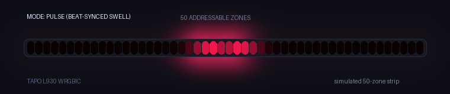
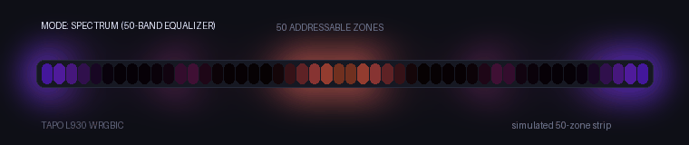
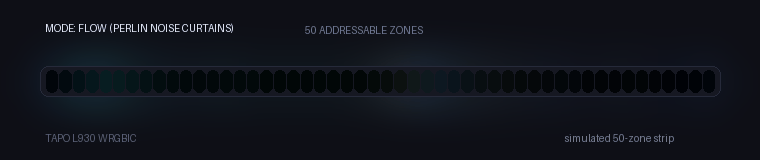
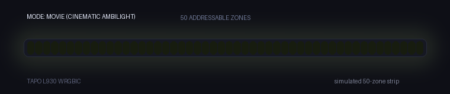
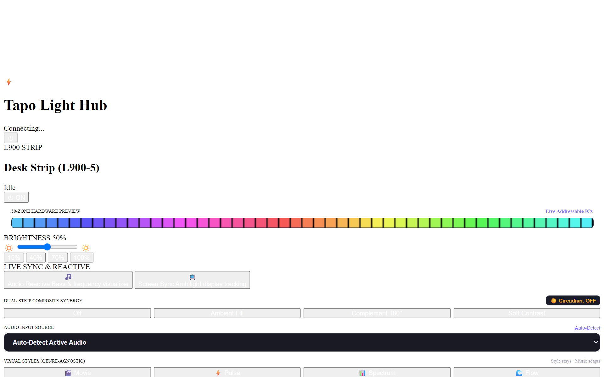

<div align="center">



<br/>

[](https://python.org)
[](#limitations)
[](LICENSE)

<br/>

**A local-first desktop controller & audio-reactive lighting engine for TP-Link Tapo smart light strips.**  
Controls strips directly over your local area network (LAN) with zero cloud round-trips for real-time updates.

[Key Features](#-key-features) • [Quick Start](#-quick-start) • [Limitations](#-limitations) • [Security](#-security) • [Effects Catalog](#-complete-effects-catalog) • [Credits](#-credits--disclaimer)

<br/>


<p align="center"><em>Real effect engine simulation of the Tapo L930 50-zone addressable strip in Pulse mode.</em></p>

</div>

---

## 💡 What Is This?

Controlling lights through a mobile app introduces cloud latency and breaks your desktop workflow. **Summer, Please Turn Off The Lights** communicates with your TP-Link Tapo light strips (tested with **L900** and **L930**) directly over your LAN using local KLAP/TPAP protocol handshakes.

Initial device discovery and pairing require your TP-Link account credentials, but all runtime lighting updates, animations, and sound-reactive commands are sent directly from your PC to the strip's local IP address.

---

## ⚡ Key Features

1. **Local LAN Streaming & Firmware Looping Hybrid**
   - Live music and movie reactive modes stream dynamically over your LAN at safe, measured rates (4–8 updates/sec).
   - Complex ambient animations (Tide, Drift, Breathe, Starfield, Embers) execute directly inside the L930 microcontroller firmware at 60+ FPS with **zero network traffic**.
   - Single-zone strips (L900) update Hue, Saturation, and Brightness in a single combined network call rather than three separate requests.

2. **Perceptual Audio-Reactive Engine (OKLab)**
   - Desktop audio loopback capture with sub-5ms FFT analysis, transient kick detection, and tempo tracking.
   - All color interpolation is calculated in **perceptual OKLab color space**, eliminating muddy brown/grey transitions between contrasting hues.

3. **Unified Dual-Strip Orchestration & Dashboard**
   - Concurrently coordinates two light strips: a single-zone monitor bias light (L900) and an addressable 50-zone bed backboard (L930).
   - Includes a dark-mode desktop tray application and a responsive web dashboard accessible across your LAN.

---

## 🎬 Live Modes Showcase

| Mode | Simulated 50-Zone Hardware Output |
| :--- | :--- |
| **Pulse**<br>*Rhythm & Kick Drum Swell* |  |
| **Spectrum**<br>*Mirrored 50-Band Equalizer* |  |
| **Flow**<br>*Dual-Octave Noise Curtains* |  |
| **Movie**<br>*Cinematic Ambilight Sync* |  |

<details>
<summary><strong>📸 View Web Dashboard Screenshots</strong></summary>

<br/>

| Mode | Dashboard Interface (1280x800) |
| :--- | :--- |
| **Pulse** |  |
| **Spectrum** |  |
| **Flow** |  |
| **Movie** |  |

</details>

---

## 🚀 Quick Start

> **Note:** This project is **Windows 10 / 11 only** (tested on Python 3.13).

### 1. Clone & Install Dependencies
```bash
git clone https://github.com/iamp1000/summer-please-turn-off-the-lights.git
cd summer-please-turn-off-the-lights

# Create and activate virtual environment
python -m venv venv
venv\Scripts\activate

# Install requirements
pip install -r requirements.txt
```

### 2. Configure Credentials (`.env`)
Create a `.env` file in the project root with your TP-Link Tapo account credentials (used locally for the KLAP token handshake):
```env
TAPO_EMAIL=your_tapo_email@example.com
TAPO_PASSWORD=your_tapo_password

# Optional: Token protection for web dashboard (leave empty for open LAN access)
TAPO_WEB_TOKEN=
```

### 3. Configure Devices (`config.yaml`)
Create or edit `config.yaml` to specify your light strips' static local IP addresses:
```yaml
tapo:
  devices:
    strip1:
      ip: "192.168.1.145" # Replace with your L900 static IP
      name: "Desk Monitor"
    strip2:
      ip: "192.168.1.146" # Replace with your L930 static IP
      name: "Bed Backboard"
```

### 4. Launch
Run via the included batch script or python module:
```bash
run_lights.bat
# or
python -m src.main
```
The web dashboard will be available at `http://localhost:8765`.

---

## ⚠️ Limitations

We believe in complete technical transparency about hardware constraints:

* **Windows Only:** Audio loopback uses Windows WASAPI (`soundcard`), screen synchronization uses Windows Desktop Duplication via DirectX (`dxcam`), and global hotkeys hook into Windows APIs (`ctypes.windll.user32`). There is currently no Linux or macOS support.
* **Microcontroller Rate Limits:** The Tapo L930 onboard microcontroller has limited network buffer capacity. Pushing more than ~8 state updates per second can overwhelm its TCP stack and cause the device to temporarily drop off the network. The pipeline enforces an update budget (typically 4–8 updates/sec for live streaming), while ambient animations run as native firmware loops.
* **Tapo Mobile App Sync Quirks:** When streaming frequent local frames over LAN, the official Tapo mobile app may occasionally report the strip as offline or delay updating its state in the cloud UI. The strip remains fully responsive to local LAN commands.
* **Initial Cloud Pairing:** While frame transmission operates purely over LAN, initial device pairing, Wi-Fi onboarding, and account credential validation are managed by the TP-Link Tapo cloud and app ecosystem.

---

## 🔒 Security

* **Local LAN Access by Default:** The web dashboard (`http://localhost:8765`) allows unauthenticated control by default across your local Wi-Fi. If running on a shared network or binding to `0.0.0.0`, configure `TAPO_WEB_TOKEN` in `.env` to require a bearer token before unlocking control.
* **Secrets Management:** `.env`, `config.yaml`, and local logs are strictly excluded in `.gitignore`. A full secret scan has been performed across the git history to guarantee no credentials or private IPs are tracked.
* **Local Handshake:** Your Tapo password is used solely to derive session keys for the local KLAP/TPAP protocol handshakes and is never transmitted outside your network.

---

## 📖 Complete Effects Catalog

<details>
<summary><strong>Click to expand the full Effects & Lighting Modes Catalog</strong></summary>

<br/>

### 1. Primary Sound & Media Reactive Modes

Both strips operate concurrently with real-time audio synchronization:

| Mode | L900 (Single-Zone Monitor Bias) | L930 (50-Zone Addressable WRGBIC) |
| :--- | :--- | :--- |
| **Movie** | **Direct Ambilight + Flare:** Tracks the luminance-weighted average of screen content (smoothing tau = 0.6s). Floor at 18%. Low-frequency impacts trigger brightness flare; dialogue frequencies suppress audio reactivity. | **Room Fill Glow + Flare:** Warm base (2700K) drifting toward screen dominant color (tau = 3-5s). Low-band impacts send warm flare spreading outward from center (60ms attack, 800ms decay). |
| **Pulse** | **Beat-Synced Swell:** Dynamic single-zone swell on kick drum detection with trailing exponential decay. Steps through palette on bar boundaries. | **Concentric Gaussian Ripples:** Spawns 2-4 zone wide Gaussian waves from center outward on each kick drum. Wave velocity scales with BPM. Color cycles per bar. |
| **Spectrum** | **Energy & Balance Wash:** 20ms attack tracking overall RMS volume with 600ms release. Hue dynamically shifts warm for bass-heavy or cool for treble-heavy audio. | **Mirrored 50-Band Equalizer:** Mirrored 50-band audio spectrum display (sub-bass in center, highs at ends) with peak-hold markers that fall over 600ms. |
| **Flow** | **Organic Breathing Wash:** Slow cyclic wash drifting across the active palette synchronized to tempo (brightness breathes between 30% and 90%). | **2-Octave Perlin Noise Curtains:** Dual-octave noise curtains flowing across 50 zones. When harmonic ratio is high, adds dominant-pitch Melody Glow. |

---

### 2. L900 Single-Zone Ambient Effects

* **`ambient_drift`**: Gentle, very slow cycling through calming tones with subtle brightness breathing.
* **`fireplace`**: Warm amber and orange embers with organic pseudo-random micro-flicker.
* **`golden_hour`**: Sunset ambers, honey golds, and soft oranges designed for evening winding down.
* **`ocean_waves`**: Deep navy blues, cyan ripples, and turquoise swells oscillating like sea waves.
* **`color_breath`**: Smooth sine-wave brightness breathing from 10% to 100%.
* **`candle_flicker`**: Fast pseudo-random micro-fluctuations in warm yellow/orange emulating a candle.

---

### 3. L930 Addressable Effects (From Registry)

#### Ambient Effects
* **`tide`** *(firmware)*: Layered slow ocean waves with pale highlights (Pacifica-style)
* **`drift`** *(firmware)*: Muted 16-color glide across the strip with 6s transition
* **`dusk`** *(streamed, <= 2 ups)*: Warm to rose to violet over many minutes (circadian-linked)
* **`breathe`** *(firmware)*: Slow 6-8s whole-strip breathing cycle for winding down
* **`starfield`** *(firmware)*: Sparse soft twinkles on dark navy background
* **`embers`** *(firmware)*: Very dim warm glow with slow random flicker for sleeping
* **`lava_lamp`** *(streamed, <= 2 ups)*: Viscous molten metaballs drifting with long transitions
* **`golden_hour`** *(streamed, <= 2 ups)*: Warm sunset twilight and radiating golden dust
* **`sunrise`** *(firmware)*: Native progressive dawn awakening sequence
* **`sunset`** *(firmware)*: Native twilight fade sequence
* **`flicker`** *(firmware)*: Native candlelight micro-fluctuation

#### Motion Effects
* **`hearth`** *(firmware)*: Restrained flame simulation with glowing ember foundation
* **`comet`** *(firmware)*: Bright comet head with cooling chromatic tail traversing the strip
* **`cyber_chase`** *(firmware)*: Two color pulses passing through each other and adding at intersection
* **`vaporwave_neon`** *(firmware)*: Slow aesthetic gradient drift in magenta, cyan, and violet
* **`sonar_sweep`** *(firmware)*: Smooth radar sweep with soft exponential fading tail
* **`neon_heartbeat`** *(firmware)*: Slow soft double-pulse rhythm for evening relaxation
* **`lantern_sweep`** *(firmware)*: Slow Cylon-style light gliding back and forth with glowing tail
* **`aurora`** *(firmware)*: Polar light ribbon sequence with wide spread and long transition
* **`deep_ocean`** *(firmware)*: Layered blue-green oceanic wave sequence
* **`ocean`** *(firmware)*: Native aqua and deep ocean swells
* **`raindrop`** *(firmware)*: Native soft droplets falling along strip
* **`lightning`** *(firmware)*: Native electric storm flashes

#### Seasonal & Novelty Effects
* **`police`** *(firmware)*: Split-strip alternating emergency flasher sequence
* **`candy_cane`** *(firmware)*: Native peppermint red and crisp white bands
* **`haunted_mansion`** *(firmware)*: Native spooky emerald green and eerie purple lightning flashes
* **`rainbow`** *(firmware)*: Native classic rainbow gradient sequence

---

### 4. Perceptual Color Palettes (OKLab)

* **Auto (Mood-based):** Dynamically derived from track energy, valence, and detected musical key.
* **Sunset:** Deep night purple -> crimson -> sunset orange -> warm amber -> golden light.
* **Forest:** Abyssal pine -> emerald -> spring leaf -> lime zest -> sunlight canopy.
* **Fire:** Cold ember -> dark blood red -> blaze orange -> flame yellow -> warm white hot.
* **Pastel:** Soft lavender -> powder sky blue -> tranquil mint -> soft peach.
* **Tide:** Pacifica ocean blues -> cerulean -> aquamarine -> seafoam crest.
* **Dusk:** Twilight rose -> magenta twilight -> deep amethyst violet.
* **Ember:** Glowing coals: deep mahogany red -> glowing ember orange -> dim warm amber.
* **WarmMono:** Ultra-clean cozy 2700K warm white golden ambience.

</details>

---

## 🛠️ Credits & Disclaimer

* **Inspiration:** Developed with deep gratitude to the open-source lighting and firmware communities, notably [WLED](https://github.com/Aircoookie/WLED) and [FastLED](https://github.com/FastLED/FastLED) for their pioneering work on addressable LED algorithms, Pacifica waves, and Fire2012 heat models.
* **Color Science:** Based on the uniform [OKLab color space](https://bottosson.github.io/posts/oklab/) created by Björn Ottosson.
* **Disclaimer:** This project is an independent open-source tool and is **not** affiliated with, endorsed by, or supported by TP-Link or Tapo. TP-Link, Tapo, and their respective logos are registered trademarks of TP-Link Corporation Limited.
* **License:** [MIT License](LICENSE)
